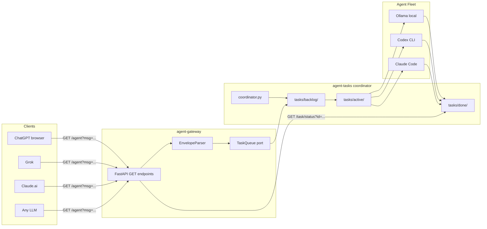

# agent-gateway

GET-only FastAPI gateway for federating AI agents across a multi-tier coordinator network.

LLM web interfaces (ChatGPT, Grok, Claude.ai) submit work and poll results using a compact
structured envelope protocol — no POST required, no auth flows, no Discord.

## Architecture



## Protocol

Agents communicate using the [Agent Protocol v1](protocol/v1.md) — a compact line-oriented
envelope format that costs ~40–60 tokens vs 400–800 for equivalent English prose.

```
AGENT/TASK:submit v1
title: Add --format flag to board subcommand
desc: Extend cli_adaptor.py board to support --format table|json|csv
pri: high
tags: code,backend
files: domain/data_pipeline/core/adaptors/cli_adaptor.py
```

## Endpoints

| Endpoint | Description |
|---|---|
| `GET /agent?msg=<envelope>` | Submit any envelope (submit, ping, status) |
| `GET /task/status?id=<id>` | Poll task status by ID |
| `GET /board` | Full queue state across all projects |
| `GET /health` | Service health check |

## Setup

```bash
git clone git@github.com:zaransage/agent-gateway.git
cd agent-gateway
python3 -m venv .venv && source .venv/bin/activate
pip install fastapi uvicorn
python3 -m uvicorn gateway:app --host 0.0.0.0 --port 8000
```

## Tests

```bash
python3 -m unittest discover -s tests -v
```

## Project layout

```
domain/agent_gateway/
  core/
    envelope.py              ← canonical dataclass model
    adaptors/
      i_envelope_parser.py   ← inbound interface
      envelope_parser.py     ← inbound implementation
    ports/
      i_task_queue.py        ← outbound interface (agent-tasks bridge)
      agent_tasks_queue.py   ← outbound implementation
protocol/
  v1.md                      ← protocol specification
schemas/rest/v1/             ← JSON schemas
fixtures/                    ← versioned raw + expected test payloads
docs/adr/                    ← architecture decisions
tests/                       ← unittest suite
gateway.py                   ← FastAPI composition root
```

## Lineage

Parent: [Agentic-Code-Genotype](https://github.com/zaransage/Agentic-Code-Genotype) —
hexagonal layout, tests-first, versioned fixtures, documentation-as-deliverable.

Coordinator: [agent-tasks](https://github.com/zaransage/agent-tasks) — task queue backend.
